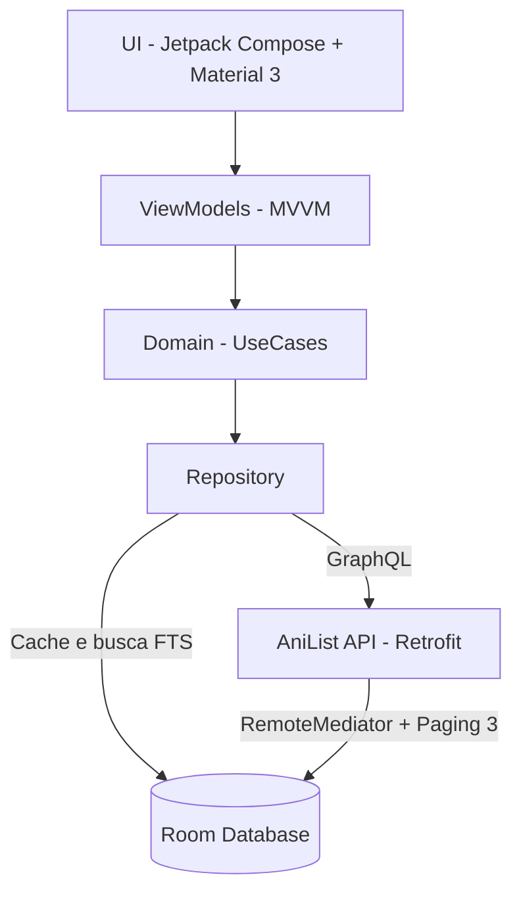

<div align="center">

# Kagura 神楽
### Sua jornada definitiva pelo universo dos animes e mangás.

<p align="center">
  
  
  
</p>

<p align="center">
  <b>Um sorteador de animes e mangás guiado pelo seu clima: tranquilo, intenso ou super intenso.</b>
</p>

<p align="center">
  
  &nbsp;
  
  &nbsp;
  
</p>

</div>

---

## Sobre o projeto

**Kagura** (神楽, a dança sagrada japonesa) é um app Android que ajuda você a decidir o que assistir ou ler a seguir. Em vez de escolher por gênero, você escolhe o **clima do momento** e o app sorteia uma recomendação do catálogo do AniList, com raridades, coleção e estatísticas, no estilo gacha.

Projeto desenvolvido como trabalho de curso, com foco em arquitetura limpa, interface própria e boas práticas do ecossistema Android moderno.

---

## Telas

<div align="center">
<table>
  <tr>
    <td align="center"><br><sub><b>Tela inicial</b></sub></td>
    <td align="center"><br><sub><b>Sorteio</b></sub></td>
    <td align="center"><br><sub><b>Dex / Coleção</b></sub></td>
  </tr>
  <tr>
    <td align="center"><br><sub><b>Busca</b></sub></td>
    <td align="center"><br><sub><b>Detalhes</b></sub></td>
    <td></td>
  </tr>
</table>
</div>

---

## Funcionalidades

### Tela inicial
- Splash inspirada na identidade do app: gradiente noturno, lua com gradiente, aura neon e tipografia KAGURA / 神楽.
- Botão interativo **Começar a Jornada**.

### Navegação
- Bottom bar com efeito *glassmorphic* e transições suaves entre 4 abas: **Sorteio, Dex, Busca e Perfil**.

### Sorteio (Gacha)
- **Tipo:** alternador animado entre Anime (rosa/lilás) e Mangá (ciano/dourado).
- **Origem:** Catálogo Geral ou Minha Lista (Quero Ver).
- **Clima:** Tranquilo, Intenso e Super intenso, que mapeiam internamente para gêneros do AniList.
- **Sorteio inteligente:** algoritmo ponderado por raridade (Comum, Raro, Épico, Lendário), pontuação e histórico do usuário.
- **Card de revelação:** animação de cápsula com ações rápidas (Ver Detalhes, Quero Ver, Sortear Outro, Compartilhar).

### Dex / Coleção
- Checklist de colecionador separado em abas (Animes e Mangás).
- Filtros por raridade e status (Completo, Em andamento, Quero ver, Nenhum).
- Barra de progresso de conclusão da coleção.

### Busca de animes
- Focada exclusivamente em animes, com sugestões em alta (Attack on Titan, One Piece, Naruto, Jujutsu Kaisen, Death Note, Frieren).
- Busca em tempo real com *debounce* via AniList GraphQL e fallback automático para busca local offline.

### Perfil e estatísticas
- Total de títulos, itens concluídos, progresso geral, episódios e capítulos salvos e lendários coletados.

### Detalhes do item
- Ficha completa: capa, título original, sinopse, nota, ano, episódios/capítulos, status e notas pessoais.

---

## Arquitetura



- **Clean Architecture + MVVM** com Jetpack Compose e Material 3.
- **Injeção de dependências:** Dagger Hilt.
- **Banco local:** Room com FTS (Full-Text Search) e cache inteligente.
- **Rede:** Retrofit + Kotlinx Serialization consumindo o AniList.
- **Paginação:** Paging 3 com RemoteMediator.
- **Desempenho:** operações de rede em segundo plano (`Dispatchers.IO`), prevenindo ANR.

---

## Tecnologias

<p align="center">
  
  &nbsp;&nbsp;
  
  &nbsp;&nbsp;
  
  &nbsp;&nbsp;
  
</p>

<p align="center">
  <b>Kotlin · Jetpack Compose · Material 3 · Hilt · Room · Retrofit · Paging 3 · Coil · DataStore · WorkManager</b>
</p>

---

## Como rodar

**Requisitos:** Android Studio recente, JDK 17 e um dispositivo ou emulador com Android 8.0 (API 26) ou superior.

```bash
git clone https://github.com/nyxaev/Kagura.git
```

1. Abra a pasta do projeto no **Android Studio** e aguarde o sync do Gradle.
2. Conecte um aparelho via USB ou inicie um emulador (AVD).
3. Clique em **Run** (`Shift + F10`).

O app consome a API pública do AniList, que não exige chave de acesso.

---

<div align="center">

Dados fornecidos pela [AniList API](https://anilist.gitbook.io/anilist-apiv2-docs/).

**Feito com carinho por [nyxaev](https://github.com/nyxaev)**

</div>