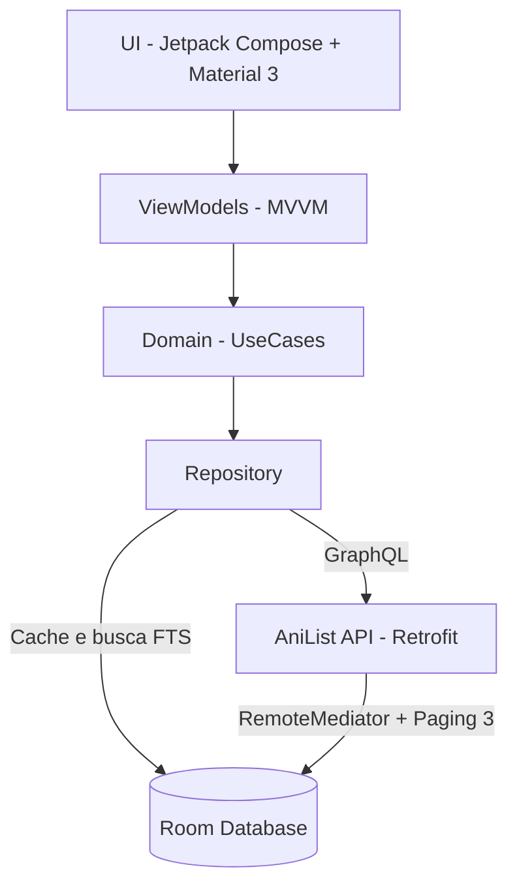

<div align="center">

<h1>Kagura</h1>

<p><sub>神楽 &nbsp;·&nbsp; <i>sua jornada pelo universo dos animes e mangás</i></sub></p>

<p align="center">
  
  
  
</p>

<p align="center">
  <i>Um sorteador de animes e mangás guiado pelo seu clima:<br>tranquilo, intenso ou super intenso.</i>
</p>

<p align="center">
  
  &nbsp;
  
  &nbsp;
  
</p>

</div>

<br>

## Sobre

Kagura (神楽, a dança sagrada japonesa) é um app Android que ajuda você a decidir o que assistir ou ler a seguir. Em vez de escolher por gênero, você escolhe o clima do momento e o app sorteia uma recomendação do catálogo do AniList, com raridades, coleção e estatísticas, no estilo gacha.

Projeto de curso, feito com foco em arquitetura limpa, interface própria e boas práticas do Android moderno.

<br>

## Telas

<div align="center">

<table>
  <tr>
    <td align="center"><br><sub>Tela inicial</sub></td>
    <td align="center"><br><sub>Sorteio</sub></td>
    <td align="center"><br><sub>Dex</sub></td>
  </tr>
</table>

<table>
  <tr>
    <td align="center"><br><sub>Busca</sub></td>
    <td align="center"><br><sub>Detalhes</sub></td>
  </tr>
</table>

</div>

<br>

## Funcionalidades

- **Tela inicial:** splash com gradiente noturno, lua em degradê e aura neon, com o botão "Começar a Jornada".
- **Navegação:** barra inferior em vidro fosco com 4 abas (Sorteio, Dex, Busca e Perfil).
- **Sorteio:** alternador animado entre Anime e Mangá, origem em Catálogo Geral ou Minha Lista, e três climas (Tranquilo, Intenso e Super intenso) que mapeiam para gêneros do AniList.
- **Raridades:** sorteio ponderado por raridade (Comum, Raro, Épico, Lendário), pontuação e histórico do usuário.
- **Card de revelação:** animação de cápsula com ações rápidas (Ver Detalhes, Quero Ver, Sortear Outro, Compartilhar).
- **Dex:** checklist de colecionador em abas (Animes e Mangás), filtros por raridade e status e barra de progresso.
- **Busca:** focada em animes, em tempo real via AniList GraphQL, com fallback para busca local offline.
- **Perfil:** total de títulos, concluídos, progresso geral, episódios e capítulos salvos e lendários coletados.
- **Detalhes:** capa, título original, sinopse, nota, ano, episódios ou capítulos, status e notas pessoais.

<br>

## Arquitetura



Clean Architecture com MVVM, injeção de dependências com Hilt, Room com FTS e cache, Retrofit com Kotlinx Serialization, Paging 3 com RemoteMediator, e rede em segundo plano (`Dispatchers.IO`) para evitar ANR.

<br>

## Tecnologias

<p align="center">
  
  &nbsp;&nbsp;
  
  &nbsp;&nbsp;
  
  &nbsp;&nbsp;
  
</p>

<p align="center">
  <sub>Kotlin · Jetpack Compose · Material 3 · Hilt · Room · Retrofit · Paging 3 · Coil · DataStore · WorkManager</sub>
</p>

<br>

## Como rodar

Requisitos: Android Studio recente, JDK 17 e um aparelho ou emulador com Android 8.0 (API 26) ou superior.

```bash
git clone https://github.com/nyxaev/Kagura.git
```

1. Abra a pasta no Android Studio e aguarde o sync do Gradle.
2. Conecte um aparelho por USB ou inicie um emulador.
3. Clique em Run (`Shift + F10`).

O app usa a API pública do AniList, que não exige chave de acesso.

<br>

<div align="center">

<sub>Dados fornecidos pela <a href="https://anilist.gitbook.io/anilist-apiv2-docs/">AniList API</a> &nbsp;·&nbsp; feito por <a href="https://github.com/nyxaev">nyxaev</a></sub>

</div>