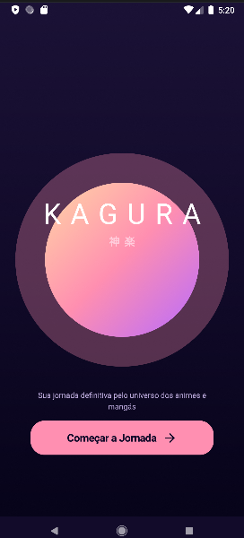
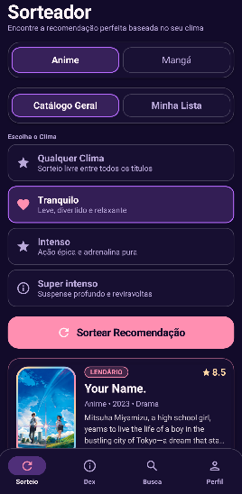
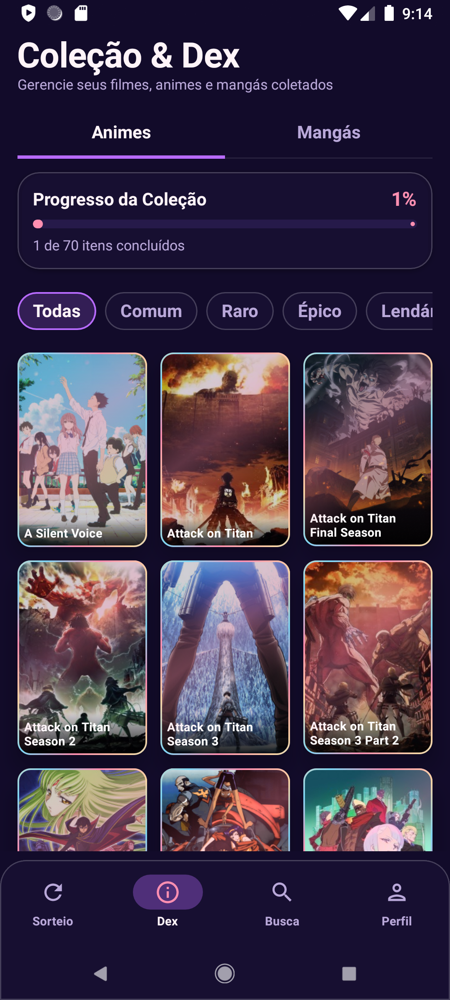
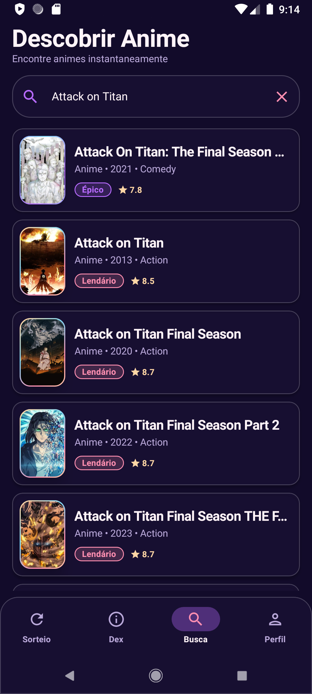
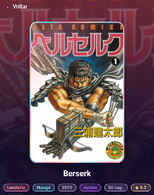

<div align="center">



<br><br>

<p align="center">
  
  
  
</p>

<p align="center">
  <i>Um sorteador de animes e mangás guiado pelo seu clima:<br>tranquilo, intenso ou super intenso.</i>
</p>

</div>

<p align="center"></p>

## Sobre

Kagura (神楽, a dança sagrada japonesa) é um app Android que ajuda você a decidir o que assistir ou ler a seguir. Com integração à API do AniList para Animes e Mangás, em vez de escolher por gênero, você escolhe o clima do momento e o app sorteia uma recomendação, com raridades, coleção e estatísticas, no estilo gacha.

Projeto de curso, feito com foco em arquitetura limpa, interface própria e boas práticas do Android moderno.

<p align="center"></p>

## Telas

<div align="center">

<table>
  <tr>
    <td align="center"><br><sub>Sorteio</sub></td>
     <td align="center"><br><sub>Sorteio</sub></td>
    <td align="center"><br><sub>Dex</sub></td>
    <td align="center"><br><sub>Busca</sub></td>
  </tr>
</table>

<table>
  <tr>
    <td align="center"><br><sub>Detalhes</sub></td>
  </tr>
</table>

</div>

<p align="center"></p>

## Funcionalidades

- **Navegação:** barra inferior em vidro fosco com 4 abas (Sorteio, Dex, Busca e Perfil).
- **Sorteio:** alternador animado entre Anime e Mangá, origem em Catálogo Geral ou Minha Lista, e três climas (Tranquilo, Intenso e Super intenso) que mapeiam para gêneros.
- **Raridades:** sorteio ponderado por raridade (Comum, Raro, Épico, Lendário), pontuação e histórico do usuário.
- **Card de revelação:** animação de cápsula com ações rápidas (Ver Detalhes, Quero Ver, Sortear Outro, Compartilhar).
- **Dex:** checklist de colecionador em abas (Animes e Mangás), filtros por raridade e status e barra de progresso.
- **Busca:** focada em animes, em tempo real via API do AniList, com fallback para busca local offline.
- **Perfil:** total de títulos, concluídos, progresso geral, episódios, capítulos e lendários coletados.
- **Detalhes:** capa, título original, sinopse, nota, ano, unidades, status e notas pessoais.

<p align="center"></p>

## Arquitetura

1. UI (Jetpack Compose + Material 3)
2. ViewModels (MVVM)
3. Domain (UseCases)
4. Repository & Data (Room Database com FTS, AniList API via Retrofit e Paging 3)

| Camada | Responsabilidade |
|:--|:--|
| `ui/` | Telas em Compose, componentes visuais, navegação e tema |
| `domain/` | Modelos e casos de uso (sorteio, filtros da Dex, cálculo de raridade) |
| `data/` | Room, AniList API, paginação e repositórios |
| `di/` | Módulos do Hilt (banco, rede, DataStore e repositórios) |

Rede em segundo plano com `Dispatchers.IO` para evitar ANR.

<p align="center"></p>

## Estrutura do projeto

<details>
<summary>Ver árvore de pastas</summary>

```
Kagura/
├── .gitignore
├── README.md
├── build.gradle.kts
├── settings.gradle.kts
├── gradle.properties
├── gradle/
│   └── libs.versions.toml
└── app/
    ├── build.gradle.kts
    └── src/
        └── main/
            ├── AndroidManifest.xml
            ├── java/
            │   └── com/
            │       └── kagura/
            │           └── app/
            │               ├── KaguraApp.kt
            │               ├── MainActivity.kt
            │               ├── data/
            │               │   ├── local/
            │               │   │   ├── AppDatabase.kt
            │               │   │   ├── GachaHistoryDao.kt
            │               │   │   ├── GachaHistoryEntity.kt
            │               │   │   ├── MediaDao.kt
            │               │   │   ├── MediaEntity.kt
            │               │   │   ├── MediaFtsEntity.kt
            │               │   │   ├── RemoteKeysDao.kt
            │               │   │   ├── RemoteKeysEntity.kt
            │               │   │   ├── SeedData.kt
            │               │   │   ├── UserStateDao.kt
            │               │   │   └── UserStateEntity.kt
            │               │   ├── model/
            │               │   │   ├── Mappers.kt
            │               │   │   └── MediaDto.kt
            │               │   ├── paging/
            │               │   │   └── MediaRemoteMediator.kt
            │               │   ├── remote/
            │               │   │   └── anilist/
            │               │   │       ├── AniListApi.kt
            │               │   │       └── AniListModels.kt
            │               │   └── repository/
            │               │       ├── FakeKaguraRepositoryImpl.kt
            │               │       ├── KaguraRepository.kt
            │               │       ├── RemoteKaguraRepositoryImpl.kt
            │               │       └── UserPreferencesRepository.kt
            │               ├── di/
            │               │   ├── DataStoreModule.kt
            │               │   ├── DatabaseModule.kt
            │               │   ├── NetworkModule.kt
            │               │   └── RepositoryModule.kt
            │               ├── domain/
            │               │   ├── model/
            │               │   │   └── MediaItem.kt
            │               │   └── usecase/
            │               │       ├── FilterDexUseCase.kt
            │               │       ├── GetRandomGachaItemUseCase.kt
            │               │       └── RarityCalculator.kt
            │               └── ui/
            │                   ├── components/
            │                   │   ├── CardEffects.kt
            │                   │   ├── CoverImage.kt
            │                   │   ├── GachaCapsuleCard.kt
            │                   │   ├── GlassComponents.kt
            │                   │   ├── Labels.kt
            │                   │   ├── RareBorder.kt
            │                   │   ├── ShimmerEffect.kt
            │                   │   └── TearMeterBar.kt
            │                   ├── navigation/
            │                   │   ├── KaguraNavGraph.kt
            │                   │   └── NavRoutes.kt
            │                   ├── screens/
            │                   │   ├── detail/
            │                   │   │   ├── DetailScreen.kt
            │                   │   │   └── DetailViewModel.kt
            │                   │   ├── dex/
            │                   │   │   ├── DexScreen.kt
            │                   │   │   └── DexViewModel.kt
            │                   │   ├── gacha/
            │                   │   │   ├── GachaScreen.kt
            │                   │   │   └── GachaViewModel.kt
            │                   │   ├── profile/
            │                   │   │   ├── ProfileScreen.kt
            │                   │   │   └── ProfileViewModel.kt
            │                   │   └── search/
            │                   │       ├── SearchScreen.kt
            │                   │       └── SearchViewModel.kt
            │                   └── theme/
            │                       ├── Color.kt
            │                       ├── Theme.kt
            │                       └── Type.kt
            └── res/
                ├── drawable/
                │   ├── ic_launcher.xml
                │   ├── ic_launcher_background.xml
                │   ├── ic_launcher_foreground.xml
                │   └── ic_launcher_monochrome.xml
                └── values/
                    ├── strings.xml
                    └── themes.xml
```

</details>

<p align="center"></p>

## Tecnologias

<p align="center">
  
  &nbsp;&nbsp;
  
  &nbsp;&nbsp;
  
  &nbsp;&nbsp;
  
</p>

<p align="center">
  <sub>Kotlin · Jetpack Compose · Material 3 · Hilt · Room · Retrofit · Paging 3 · Coil · DataStore · WorkManager</sub>
</p>

<p align="center"></p>

## Como rodar

Requisitos: Android Studio recente, JDK 17 e um aparelho ou emulador com Android 8.0 (API 26) ou superior.

1. Abra a pasta no Android Studio e aguarde o sync do Gradle.
2. Conecte um aparelho por USB ou inicie um emulador.
3. Clique em Run (`Shift + F10`).

O app utiliza a API pública do AniList, que não exige nenhuma chave de acesso.

<p align="center"></p>

<div align="center">

<sub>Dados fornecidos pela <a href="https://anilist.gitbook.io/anilist-apiv2-docs/">AniList API</a> &nbsp;·&nbsp; feito por <a href="https://github.com/nyxaev">nyxaev</a></sub>

</div>
